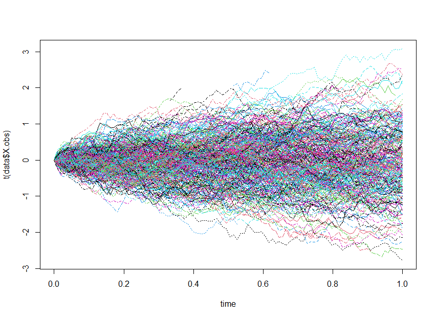
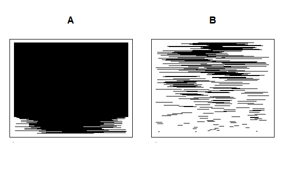
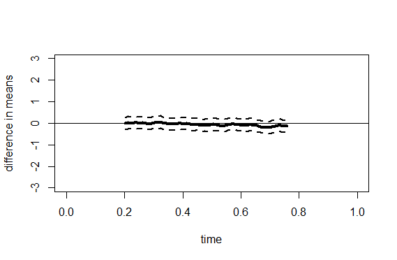

# Testing the Missing Completely at Random Assumption for Functional Data
This repository contains code to reproduce the results from the paper

> Ofner, M., Hörmann, S., Kraus, D., and Liebl, D. (2026). Testing the Missing Completely at Random Assumption for Functional Data, *submitted for publication*.

## Folder Structure

```text
fdMCAR/
├── R/
│   └── fdMCAR.R
├── Simulation/
│   ├── sim_paper
│   ├── sim_supplements
├── Figures/
└── README.md
```
The estimation method is implemented in the R script ``fdMCAR`` (its use is illustrated below). The folder ``Simulation`` contains the scripts to reproduce the simulation studies considered in the paper.

## Illustration

We briefly illustrate the use of the main function ``fdMCAR.test`` on simulated data. To this end, first load the relevant source files.

```{r}
source("R/fdMCAR.R")
source("Simulation/sim_paper/GenBM.R")
```

Using the function ``GenBM``, we generate incomplete paths of a Brownian motion as explained in the paper.

```{r}
set.seed(123)
n <- 500 # Sample size
p <- 100 # Nr of equispaced grid points
grid <- seq(0,1,length.out = p)
data <- GenBM(n = n, p = p, type.miss = "mcar")
matplot(grid, t(data$X.obs), type = "l", xlab = "time")
```



Computing

```{r}
sum(is.na(data$X.obs))/(n * p)
# [1] 0.32622
```
we observe that 32.62 % of the measurements are missing. Let us run the proposed test to check whether the data are *missing completely at random* (MCAR).

```{r}
res <- fdMCAR.test(data$X.obs, A = NULL, return.SCB = TRUE)
res$df.test
#       T.value p.value
# T_L2 2.103922   0.413
# T_mu 4.739974   0.199
# T_F  1.298509   0.334
```
By default, the test is based on an asymptotic approximation. The rows ``T_mu`` and ``T_F`` relate to the respective versions of the test that are based on a mean comparison in the sup-norm, and the comparison of distributions. The first row reports an additional mean comparison in the $L^2$-norm. The p-values are not significant which is in accordance with the fact that the data have been simulated under MCAR.

By default, the test chooses systematic groups $\mathcal{A}$ and $\mathcal{B}$ based on clustering. Let us visualize the observation patterns via barcode plots.

```{r}
sample_A <- res$sample_A
sample_B <- setdiff(1:n, res$sample_A)
par(mfrow = c(1,2))
PlotSets(!is.na(data$X.obs[sample_A,]), max(length(sample_A), length(sample_B)),
         res$centers[1,])
title("A")
PlotSets(!is.na(data$X.obs[sample_B,]), max(length(sample_A), length(sample_B)),
         res$centers[2,])
title("B")
```


```{r}
length(sample_A) # Nr of sets in A
# [1] 310
```

Here, 310 out of 500 sets are assigned to group $\mathcal{A}$.

Finally, we visualize the estimated difference in mean functions.

```{r}
diff <- res$mean.diff$diff
q    <- res$mean.diff$q
distance <- (max(data$X.obs, na.rm = TRUE) - min(data$X.obs, na.rm = TRUE))/2
rg <- c(-distance, distance)
plot(grid, diff, type = "l", xlab = "time", ylab = "difference in means",
     ylim = rg, lwd = 4)
lines(grid, diff +  q/sqrt(n), lty = 2, lwd = 2)
lines(grid, diff -  q/sqrt(n), lty = 2, lwd = 2)
abline(h = 0, lty = 1, lwd = 1)
```


